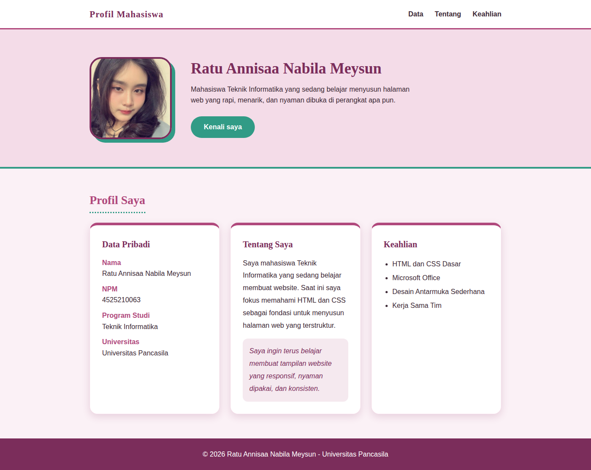
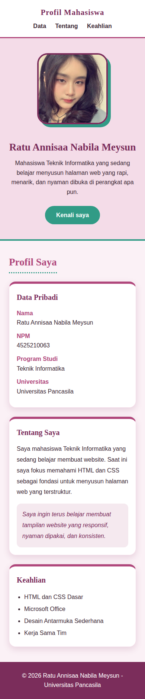
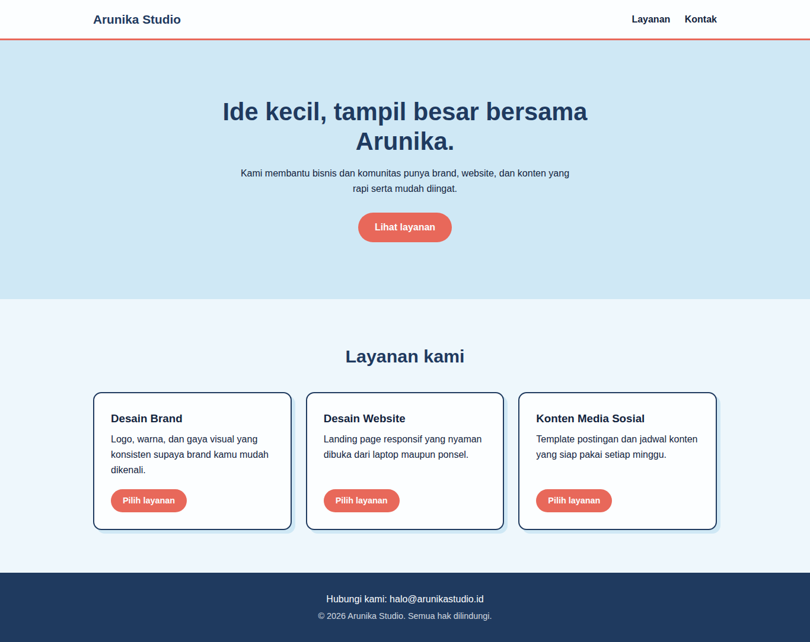
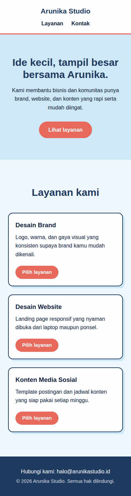

# Tugas Praktikum Pertemuan 4 - Desain Web

**Nama:** Ratu Annisaa Nabila Meysun
**NPM:** 4525210063
**Kelas:** A

## Tugas Individu
Membangun ulang halaman profil menjadi dua file (`index.html` dan `style.css`) dengan box model, minimal dua class reusable, dan satu media query di bawah 768px.

## File
| File | Keterangan |
|---|---|
| `index.html` | Struktur halaman profil (header, hero, data, tentang, keahlian, footer) |
| `style.css` | Seluruh CSS (tanpa CSS inline/internal) |
| `img/ratu.jpg` | Foto profil |
| `arunika-studio/` | Studi kasus landing page Arunika Studio (sudah dirapikan) |
| `screenshots/` | Tampilan desktop dan mobile |

## Yang Dipakai
- **Box model:** `box-sizing: border-box`, `padding`, `border`, dan `margin` pada `.container` dan `.card`.
- **Card:** tepat 3 card (Data Pribadi, Tentang Saya, Keahlian); 3 kolom di desktop, 1 kolom di mobile.
- **Class reusable:** `.container`, `.card`, `.section-title`, `.btn`.
- **Media query:** `@media (max-width: 767px)` untuk layar di bawah 768px.

## Screenshot
| Halaman | Desktop | Mobile |
|---|---|---|
| Profil |  |  |
| Arunika Studio |  |  |

## Ringkasan Perubahan, Masalah, dan Solusi
Pada pertemuan ini saya menyusun ulang halaman profil dari pertemuan 3 yang awalnya memakai CSS inline menjadi dua file terpisah: index.html untuk struktur dan style.css untuk tampilan. Perubahan utamanya adalah semua gaya dipindahkan ke satu file CSS, lalu ditambahkan header, hero, dan footer. Saya menerapkan box model memakai padding, border, margin, dan box-sizing border-box supaya ukuran elemen lebih mudah diperkirakan. Class reusable seperti container, card, section-title, dan btn dibuat agar satu aturan bisa dipakai berulang kali. Masalah yang saya temui adalah gaya yang berserakan di banyak elemen ketika memakai CSS inline, dan tiga card yang terasa sempit bila tetap berjajar di layar ponsel. Solusinya, semua gaya dikumpulkan di satu tempat dan saya menambahkan satu media query pada lebar di bawah 768px yang membuat hero menjadi vertikal dan tiga card menjadi satu kolom. Halaman studi kasus Arunika Studio juga saya rapikan dengan struktur main, tombol yang sejajar di dasar card, dan card yang menumpuk pada layar kecil. Kedua halaman sudah diuji di desktop dan mobile tanpa scroll horizontal.

## Pembagian Peran
Tugas ini individu, sehingga seluruh pengerjaan (HTML, CSS, pengujian, dokumentasi) dilakukan oleh Ratu Annisaa Nabila Meysun.
