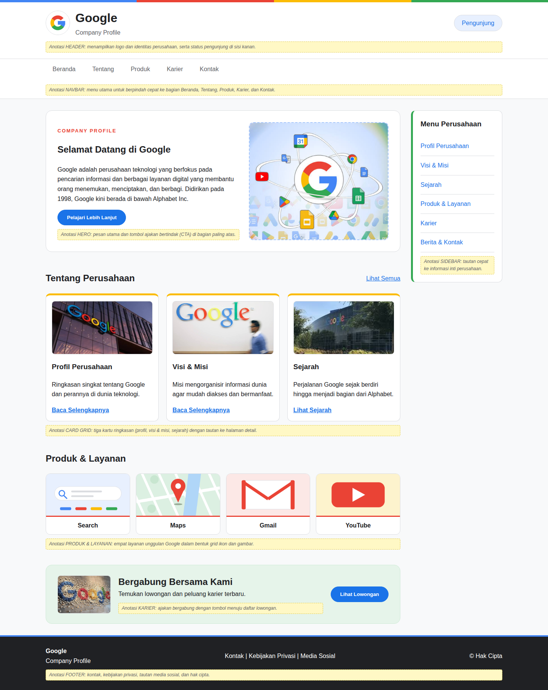
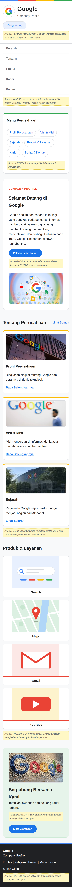

# Tugas Praktikum Pertemuan 5 - Desain Web

**Nama:** Ratu Annisaa Nabila Meysun
**NPM:** 4525210063
**Kelas:** A

## Tugas Kelompok & Bukti Praktikum
Membuat wireframe desktop dan mobile beserta anotasi fungsi area dengan tema **Company Profile (Google)**, dalam dua file (`index.html` dan `style.css`), tingkat fidelitas mid-fidelity.

## File
| File | Keterangan |
|---|---|
| `index.html` | Struktur wireframe (header, navbar, sidebar, hero, card grid, produk dan layanan, karier, footer) |
| `css/style.css` | Seluruh CSS (tanpa CSS inline/internal) |
| `images/` | Folder aset gambar (10 gambar: logo, hero, card, produk, karier) |
| `dokumentasi/` | Tangkapan layar tampilan desktop dan mobile |

## Struktur Folder
```
pertemuan-5-tugasprak/
├── index.html
├── README.md
├── css/
│   └── style.css
├── images/
│   ├── logo.png
│   ├── hero.png
│   ├── profil.png
│   ├── visi-misi.png
│   ├── sejarah.jpg
│   ├── search.png
│   ├── maps.png
│   ├── gmail.png
│   ├── youtube.png
│   └── karier.png
└── dokumentasi/
    ├── tampilan-desktop.png
    ├── tampilan-mobile.png
    └── ringkasan.md
```

## Yang Dipakai
- **Elemen semantik:** `header`, `nav`, `main`, `aside`, `section`, `article`, dan `footer`.
- **Layout:** CSS Grid untuk layout utama (konten + sidebar di kanan), hero, card, dan produk; Flexbox untuk header, navbar, karier, dan footer.
- **Gambar:** 10 gambar di folder `images/`, dipasang dengan `` dan `object-fit` agar proporsi terjaga.
- **Anotasi:** catatan kuning pada setiap area (header, navbar, sidebar, hero, card grid, produk, karier, footer) yang menjelaskan fungsinya.
- **Media query:** `@media (max-width: 900px)` untuk tablet dan `@media (max-width: 600px)` untuk smartphone.

## Screenshot
### Tampilan Desktop (lebar 1440px)


### Tampilan Mobile (lebar 390px)


## Ringkasan Solusi
Untuk tugas ini saya membuat wireframe mid-fidelity bertema Company Profile dengan studi kasus Google, terdiri dari dua file terpisah: index.html untuk struktur dan style.css untuk tampilan. Susunan halaman mengikuti anatomi umum, yaitu header, navbar, konten utama (hero, card grid, produk dan layanan, ajakan karier), sidebar menu perusahaan, dan footer, dengan elemen semantik agar kerangkanya jelas. Setiap area saya beri anotasi berupa catatan kuning yang menerangkan fungsinya. Gambar sudah dipasang di tiap area supaya proporsi bagian-bagian halaman terlihat nyata. Masalah yang muncul adalah sidebar, tiga card, dan navbar yang menjadi terlalu sempit jika tetap berjajar di layar kecil. Untuk mengatasinya saya memakai dua media query: pada lebar maksimal 900px sidebar berubah menjadi menu horizontal dan card menjadi dua kolom, lalu pada lebar maksimal 600px semua elemen disusun satu kolom. Hasilnya sudah diuji di desktop dan mobile tanpa scroll horizontal, sehingga siap dilanjutkan ke tahap mockup visual.

## Pembagian Peran
Tugas ini individu, sehingga seluruh pengerjaan (HTML, CSS, anotasi, pengujian, dokumentasi) dilakukan oleh Ratu Annisaa Nabila Meysun.
