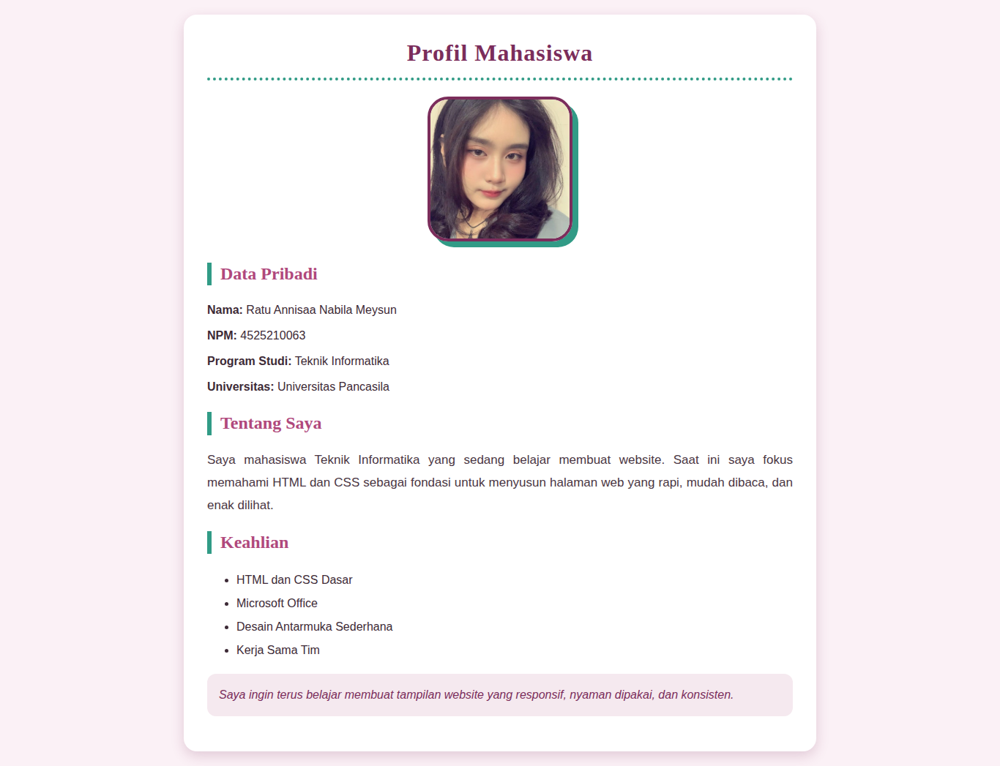
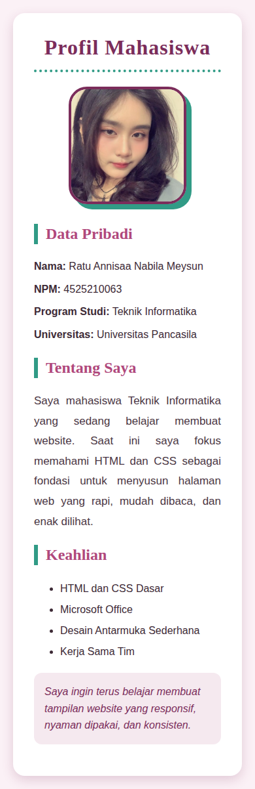
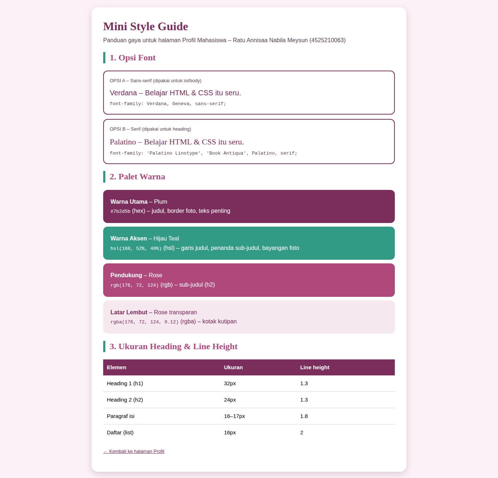
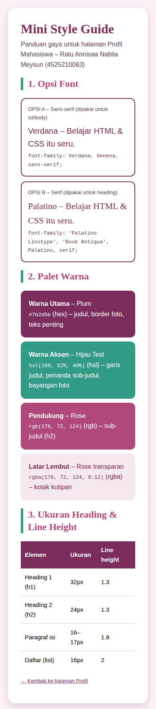

# Tugas Praktikum Pertemuan 3 - Desain Web

**Nama:** Ratu Annisaa Nabila Meysun
**NPM:** 4525210063
**Kelas:** A

## Isi Tugas

**Individu**
1. Memodifikasi Profil Pertemuan 3 dengan **10 property CSS inline** dan **4 format warna berbeda**.
2. Membuat **Mini Style Guide**: 2 opsi font, warna utama, warna aksen, ukuran heading, dan line height.

**Readme:** source code, hasil screenshot desktop/mobile, dan ringkasan kesimpulan 150-200 kata.

## File

| File | Keterangan |
|---|---|
| `index.html` | Halaman Profil Mahasiswa (CSS inline) |
| `styleguide.html` | Mini Style Guide |
| `img/ratu.jpg` | Foto profil |
| `screenshots/` | Hasil tampilan desktop dan mobile |

## 10 Property CSS Inline yang Digunakan

| No | Property | Contoh pemakaian |
|---|---|---|
| 1 | `font-family` | `Verdana, Geneva, sans-serif` (body), `Palatino Linotype, serif` (heading) |
| 2 | `color` | `#7b2d5b` pada judul |
| 3 | `background-color` | `#fbf1f6` pada body, `#ffffff` pada kartu |
| 4 | `font-size` | `32px` (h1), `24px` (h2), `16px` (isi) |
| 5 | `line-height` | `1.6` body, `1.8` paragraf, `2` daftar |
| 6 | `text-align` | `center` pada judul, `justify` pada paragraf |
| 7 | `padding` | `32px` pada kartu, `16px` pada kotak kutipan |
| 8 | `margin` | `0 auto` untuk menengahkan kartu |
| 9 | `border-radius` | `18px` kartu, `28px` foto profil |
| 10 | `box-shadow` | `0 6px 18px rgba(123, 45, 91, 0.2)` pada kartu |

Property tambahan: `border`, `border-bottom`, `border-left`, `max-width`, `font-weight`, `font-style`, `text-transform`, `letter-spacing`.

## 4 Format Warna yang Digunakan

| Format | Contoh | Dipakai untuk |
|---|---|---|
| Hex | `#7b2d5b` | Warna utama: judul h1, border foto |
| RGB | `rgb(176, 72, 124)` | Warna sub-judul (h2) |
| RGBA | `rgba(176, 72, 124, 0.12)` | Latar kotak kutipan (transparan) |
| HSL | `hsl(168, 52%, 40%)` | Warna aksen: garis judul, penanda h2, bayangan foto |

## Mini Style Guide

**Font**
- Opsi A (sans-serif, isi/body): `Verdana, Geneva, sans-serif`
- Opsi B (serif, heading): `'Palatino Linotype', 'Book Antiqua', Palatino, serif`

**Warna**
- Utama: `#7b2d5b` (plum)
- Aksen: `hsl(168, 52%, 40%)` (hijau teal)
- Pendukung: `rgb(176, 72, 124)` dan `rgba(176, 72, 124, 0.12)`

**Ukuran heading dan line height**

| Elemen | Ukuran | Line height |
|---|---|---|
| h1 | 32px | 1.3 |
| h2 | 24px | 1.3 |
| Paragraf | 16-17px | 1.8 |
| Daftar | 16px | 2 |

Versi lengkap dengan contoh visual ada di `styleguide.html`.

## Screenshot

### Halaman Profil
| Desktop | Mobile |
|---|---|
|  |  |

### Mini Style Guide
| Desktop | Mobile |
|---|---|
|  |  |

## Ringkasan Kesimpulan

Pada tugas ini saya mengubah halaman Profil Mahasiswa agar bergaya lewat CSS inline, yaitu atribut style yang dituliskan langsung di setiap elemen HTML. Ada lebih dari sepuluh property yang saya pakai, antara lain font-family, color, background-color, font-size, line-height, text-align, padding, margin, border-radius, border, box-shadow, dan max-width. Saya juga mencoba empat format warna, yaitu hex, rgb, rgba, dan hsl. Dari situ saya mengerti bahwa satu warna dapat ditulis dengan beberapa cara, dan rgba memungkinkan transparansi sedangkan hsl memudahkan mengatur kecerahan warna. Selain itu saya menyusun mini style guide berisi dua pilihan font, warna utama, warna aksen, ukuran heading, dan line height supaya tampilan konsisten. Kesimpulannya, CSS inline cepat dipakai dan hasilnya langsung terlihat, tetapi gaya yang sama harus diulang di banyak tempat sehingga sulit dirawat pada halaman yang besar. Untuk proyek yang lebih serius, file CSS terpisah akan lebih efisien. Tampilan halaman juga sudah saya cek pada ukuran desktop dan mobile agar tetap rapi.
